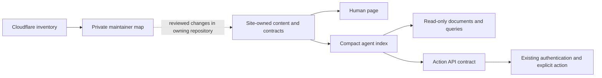

# Cloudflare surfaces: one content owner, clear ways in

This is a private maintainer map for the Cloudflare web estate. It belongs to
the GitHub KINGDOM-OS web repository. It does not replace the Codeberg core
registry, a site's own source contract, or an API's authorization rules.

## Layout

| Lane | What belongs here | First useful response |
| --- | --- | --- |
| Human | Purpose, current state, readable content, accessible navigation and deliberate actions | A useful page, including a no-JavaScript reading path where practical |
| Agent | A compact discovery index, typed data, API contracts, examples, exact errors and limits | A small valid document with the next URL; no browser hydration required |
| Shared | Source-owned facts, public records, schema versions, lifecycle, provenance and correction history | Both presentations derive from the same authored material |
| Operator | Deployment, account inventory, internal hostnames, credentials, diagnostics and recovery | Authenticated tooling or this private repository; never a public discovery bundle |

Audience is a presentation choice, not an access-control mechanism. A person
may read JSON and an agent may use HTML. Do not grant capabilities by User-Agent,
audience labels, a public link, or possession of a source document. State-changing
operations keep their existing authentication, consent and transaction rules.

## Routing and content rules

1. Each public site chooses one human start URL and, **if it supports agent
   use**, one small agent start URL. Reuse its existing manifest or API catalog.
   Do not manufacture an API for a reading room or game.
2. Link both starts from the human page and advertise the machine document with
   an appropriate `Link` header or HTML alternate. Prefer explicit URLs over
   user-agent guessing. Keep existing links compatible during migration.
3. Target a 5 KB agent start document. Put purpose, observed/declarative status,
   human URL, typed next links and required authentication there. Keep full
   guides and catalogs one link deeper. This is a portfolio design budget, not
   a new external protocol or a universal standard.
4. Serve JSON as JSON, text as text, and real missing resources as 404. A
   successful HTML fallback at a `.json` URL is not a machine interface. Keep
   SPA navigation fallback within human routes; exclude machine namespaces.
5. Separate read contracts from action contracts. Document method, inputs,
   outputs, authentication, pagination, timeouts and retry/idempotency behavior
   where applicable. A listing must not silently invoke the listed service.
6. Author facts once in the source-owning repository. Generate thin human and
   machine views. Link to other owners instead of copying their whole payload.
   Preserve immutable versions and corrections; mark old entry points before
   removing them and retain a reversible route plan.
7. Keep status dimensions separate: deployment exists, URL responds, content has
   the expected type, API is usable, source is attributable, and action is
   authorized are different claims. An unprobed route is **unknown**, not broken.
8. Private GitHub source stays private. Public reading paths must use an already
   public, owner-approved edition or clearly say repository access is required.
   Never fix a public 404 by putting a GitHub token in a browser or by proxying
   arbitrary private source into a public site.

## What to remove, and what to retain

Remove repeated instructions in start documents, unsupported live/count claims,
duplicate full catalogs, missing-JSON HTML fallbacks, obsolete deployment
instructions, and competing entry points whose difference is unexplained.
Keep poetry, play, cultural language and detailed research in their intended
human or reference spaces. Their existence is not evidence of friction. Keep
rights, privacy, consent and economic obligations explicit where they affect a
decision; link to the full contract instead of repeating it at every step.

Aliases, historical editions, immutable previews and a Worker over a Pages
project are not automatically duplicates. Match content, purpose, bindings,
source owner and current use before proposing consolidation. A shared
`axiepro.workers.dev` account subdomain is an account naming choice, not proof
that every Worker depends on the AxiePro product.

## Release gate

- Read the site's current owner instructions and live deployment metadata.
  Work from a clean exact revision; preserve unrelated edits.
- Verify direct machine requests for status, media type, parseability, bounded
  size and advertised links. Include a negative machine-route case when
  changing fallbacks. Verify human navigation and an accessible reading path.
- Verify that private inventory, local paths, credentials, account metadata,
  operator pages and source bodies are absent from the exact public upload.
- Run the owner's existing integrity and runtime checks. A public metadata
  change must not rewrite a versioned publication or activate a listed API.
- Deploy the exact reviewed source through the owner's current release path.
  Check immutable deployment URL, production alias and custom domain. Record
  the previous deployment for rollback. A preview-only success is insufficient.

## Evidence and refresh

`2026-09-25/surfaces.json` is the machine-readable observation;
`2026-09-25/index.html` and `2026-09-25/MAP.md` are generated views.
`ROADMAP.md` owns the update sequence. Read timestamps and limitations before
using the snapshot. The collector performs Cloudflare API GETs only; public
content probes are separately bounded and credential-free.

Cloudflare has separate inventories for [Pages projects](https://developers.cloudflare.com/api/resources/pages/subresources/projects/methods/list/),
[Workers scripts](https://developers.cloudflare.com/api/resources/workers/subresources/scripts/methods/list/),
[Worker custom domains](https://developers.cloudflare.com/api/resources/workers/subresources/domains/methods/list/),
and [zone routes](https://developers.cloudflare.com/api/resources/workers/subresources/routes/methods/list/).
DNS ownership alone does not establish that Cloudflare hosts the application.

